# PSX Retro Tools for Blender

Bring authentic PlayStation 1-style visuals into Blender with a focused toolkit for low-poly rendering, low-resolution textures, vertex lighting, billboards, dithering, wobble, screen snapping, and retro post-processing.

**Downloaded by 16,000+ artists and developers**

[Download on itch.io](https://fawkek.itch.io/psx-retro-tools) · [Read the devlogs](https://fawkek.itch.io/psx-retro-tools/devlog) · [Follow @fawkek_obj](https://x.com/fawkek_obj)

## What It Does

PSX Retro Tools is built to make PS1-inspired workflows fast and practical inside Blender. Instead of assembling a retro look from scattered tricks and manual setup, you get a single toolkit designed for stylized low-res production.

It is aimed at 3D artists, game developers, technical artists, and retro enthusiasts who want recognizable PSX-era visuals without fighting their tools.

## Features

- **Applied to** — see every PSX effect on the active object at a glance, toggle, jump to its settings or remove it
- **PSX Asset Bake** — bake a multi-material mesh into one packed master texture, one UV map and one material
- **Texture Blend** — paint a blend mask between two textures directly on the object, preview it live and bake it
- **Low-Poly Simplifier** for fast mesh reduction and triangulation
- **Low-Resolution Texture Baking** with per-material baking by default or targeted active-material rebaking
- **Texture Generator** with checkerboards, gradients, paint-ready bases, and a labeled UV Debug Grid
- **Color Dithering** with Bayer, Floyd–Steinberg, Atkinson, and other algorithms
- **PSX PostFX** with six non-destructive material presets and real-time controls
- **Vertex Wobble and Wobble PRO** with hold frames, axis controls, per-axis amplitude, and presets
- **Vertex Screen Snapping** and **Texture Distort** for classic PS1-style instability
- **PSX Vertex Lighting / Gouraud** for baking scene lights into vertex colors
- **PSX Billboard Sprite** for static, camera-facing, and animated PNG sprites
- **Render Presets**, shadow controls, and **Pixel-Perfect Upscale**
- **PSX Retro Dither** — an integrated, non-destructive compositor post-process with pixelation, color reduction, CRT controls, grading, and LUT support
- **Built-in English and Russian guides** available from the add-on

## What's New Since 1.6.2

### 1.7.15 — Applied to, Crisp Pixels and a Big Fix Pass

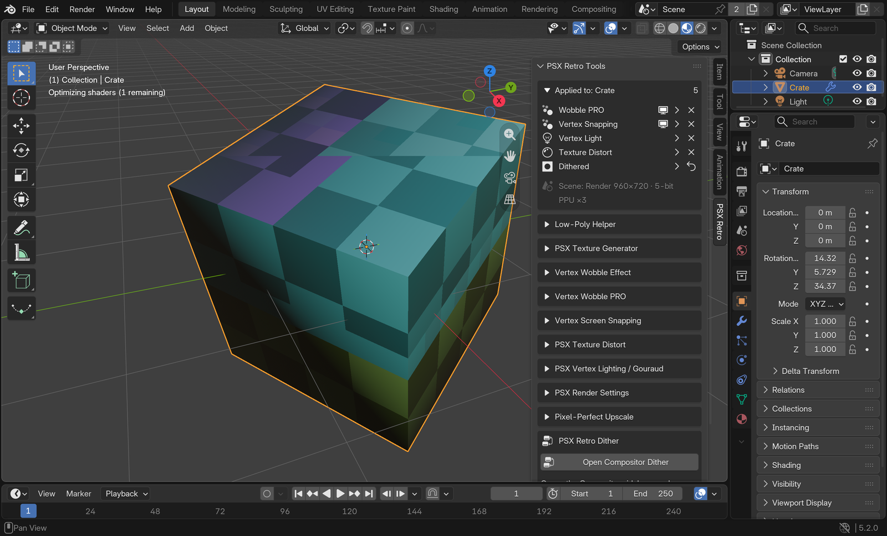

- **Applied to:** a new status block at the top of the panel lists every PSX effect on the active object — Wobble, Vertex Snapping, Vertex Light, Texture Distort, PostFX, Dithered, Baked, Billboard and more — with a viewport toggle, a jump to its settings and Remove / Restore. A Scene line shows Render resolution, Color Depth, Pixel-Perfect Upscale and Retro Dither.
- **Pixel-Perfect Upscale, rebuilt:** pixels are now hard squares instead of a blurry mush. Pixelation is measured from the base resolution — 1.0 is the exact PSX grid (e.g. 320×240), with 0.25 steps from 0.5 to 4.0, live updates and the resulting PSX resolution shown in the panel.
- **Texture Distort** now really animates its scanline wobble, applies without extra clicks and cleans up after itself.
- **Color Depth 8-bit and 16-bit** now actually reduce colors (RGB332 / RGB565).
- **Atkinson dithering** fixed — no more colors outside the palette.
- **Render Settings keeps your own compositor** as a saved node group instead of replacing it.
- **PSX Retro Dither** is packed into the .blend, so scenes render correctly on another computer or a render farm; re-applying Dither after PPU no longer produces a blank white frame.
- **Vertex Lighting:** point, spot and area lights no longer blow out to white, hidden lights are ignored, and shared materials keep their texture on other objects.

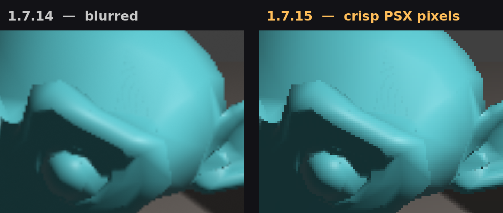

<table>
<tr>
<td>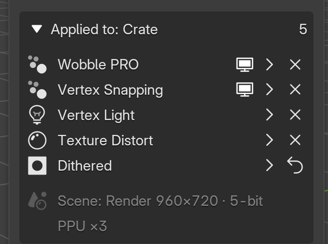</td>
<td>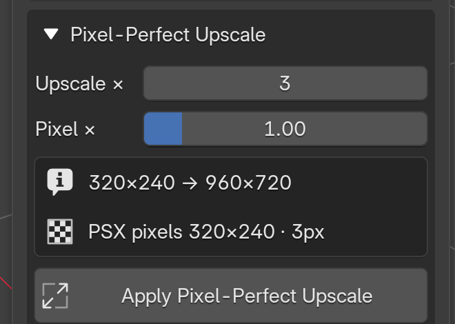</td>
<td>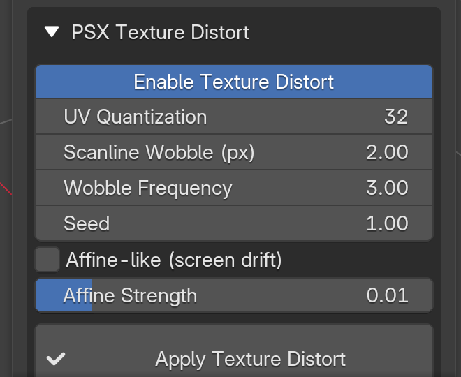</td>
</tr>
</table>

[Read the 1.7.15 devlog](https://fawkek.itch.io/psx-retro-tools/devlog/1714194/psx-retro-tools-1715-see-whats-applied-crisp-pixels-and-a-big-fix-pass)

### 1.7.14 — Texture Blend and PSX Asset Bake

- **Texture Blend:** select a mesh, pick two of its Image Textures, paint a grayscale transition mask directly on the object, preview it live, then bake the blend. Source images and unrelated material slots stay untouched.
- Only Base Color changes — the original shader's Roughness, Normal and other settings are kept.
- Auto, Smart UV and Per-Face Atlas unwrap modes for the mask; Auto handles long roads.
- Source UVs are preserved through Texture Coordinate → Mapping chains.
- Safe handling of imported object names and optional hiding of the original to prevent z-fighting.

- **PSX Asset Bake:** multi-material, multi-image meshes bake to one master texture and one final material on a `_BAKED` copy — fewer materials and draw calls for game-ready assets.
- Dedicated `PSX_Baked_UV` map with Smart UV packing, 4 px default margin, alpha preservation and nearest filtering; the PNG is saved next to the .blend file.
- Fixed Blender 5.2 solid Base Color values being read as white.
- The classic Per Material / Active Material bake remains available.

### 1.7.12 — Blender Extension Packages

- Distributed as a Blender Extension ZIP with Pillow bundled — no manual pip install or dependency installer.
- Separate downloads for Windows x64, Linux x64 and one macOS package for both Apple Silicon and Intel.
- Supports Blender 5.0–5.2.
- Bake works on material copies: original materials, other objects sharing them, UV maps, selection and bake settings are preserved, and failed bakes restore everything.
- **Restore Original Materials** after baking, even after saving and reopening the .blend.
- Undo Dithering restores the first original texture after repeated applies, renaming, resizing and save/reload; dithering keeps alpha.

### 1.7.8–1.7.11 — Stability

- Pixel-Perfect Upscale: the visible upscale value is always used, reapplying is safe, and PPU/Dither ordering is preserved either way.
- Blender 5.2 Geometry Nodes compatibility for Vertex Screen Snapping and Vertex Wobble PRO.
- Vertex Screen Snapping picks the selected, active or only scene camera automatically.
- Fixed Windows Blender 5.1 crashes during live compositor slider updates.

### 1.7.5 — Self-Contained Compositor and Stability

- The complete PSX Retro Dither graph is now generated by the add-on itself, with no external `.blend` asset required.
- Added safeguards for a Windows Blender 5.1.2 crash involving compositor helper groups.
- Threshold now influences every output mode, and the default pre-brightness was corrected to match the intended look.
- Applying, updating, bypassing, or removing the effect reconnects the surrounding compositor chain more safely.
- 3D `.cube` LUTs now use an improved matrix-and-bias approximation with neutral-axis curve correction; 1D LUTs continue to use per-channel curves.

### 1.7.4 — Integrated PSX Retro Dither

- Added an opt-in compositor effect for the final render. Open the compositor controls, then press **Add Post-Process** to enable it.
- Shape the image with pixelation, color quantization, sharpening, pre-brightness, threshold, final brightness, contrast, saturation, and gamma.
- Choose Original, Custom RGB, Two Colour, or monochrome output, with presets for quick retro looks.
- Added CRT-style bulge, chromatic aberration, fill-frame, projector curve, and edge jitter controls.
- Added optional `.cube` and `.lut` color looks.
- Render Settings and Pixel-Perfect Upscale preserve an existing dither effect and restore it after PPU in the correct chain order.
- Fixed Blender 5 compositor socket handling for the CRT controls.

[Read the 1.7.4 devlog](https://fawkek.itch.io/psx-retro-tools/devlog/1567296/psx-retro-tools-174-is-focused-on-giving-you-more-artistic-control-over-the-final-look-of-your-work)

### 1.7.0 and 1.6.3 — New Production Tools

- **PSX Billboard Sprite:** import PNG billboards in Static, Face Camera Full, or Face Camera Yaw Only modes; use numbered image sequences, looping, nearest-neighbor filtering, and Alpha Clip, Alpha Blend, or Opaque materials.
- **PSX Vertex Lighting / Gouraud:** bake Sun, Point, Spot, and Area lights into vertex colors, with ambient controls and Full, PSX 5-bit, or custom color quantization.
- **Texture workflow redesign:** bake a separate low-resolution diffuse texture for each material by default, or rebake only the active material. Baking now has an independent palette-size control.
- Added six one-click material PostFX presets: Clean PSX, Soft Dither, Strong Dither, Crunchy Low Color, Dark Contrast, and Washed Old Screen.
- Added a labeled UV Debug Grid for checking UV orientation, placement, and distortion.
- Added bundled English and Russian HTML guides and updated the add-on for Blender 5 APIs.

[Read the 1.7.0 devlog](https://fawkek.itch.io/psx-retro-tools/devlog/1541791/psx-retro-tools-170-is-here-a-major-blender-50-update-focused-on-ps1-style-materials-texture-workflows-vertex-lighting-and-billboard-sprites)

## Why Artists Use It

- Fast one-click setup for a retro rendering pipeline
- Built for game art, animation, experiments, and stylized indie projects
- Designed around practical production tasks, not just visual gimmicks
- Keeps the workflow inside Blender instead of splitting it across multiple tools

## Preview

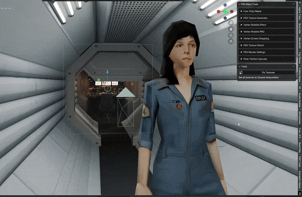

 

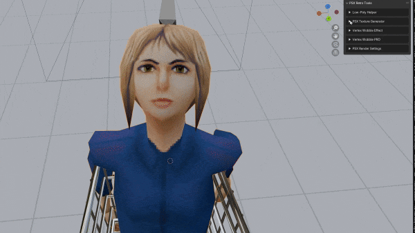

 

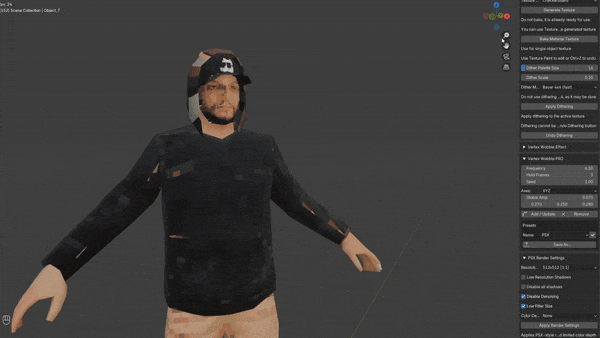

 

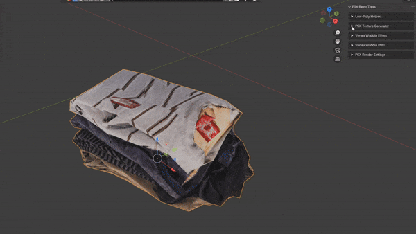

 

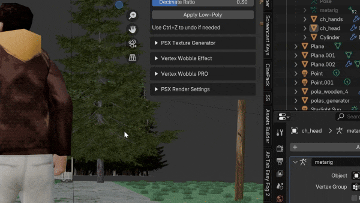

 

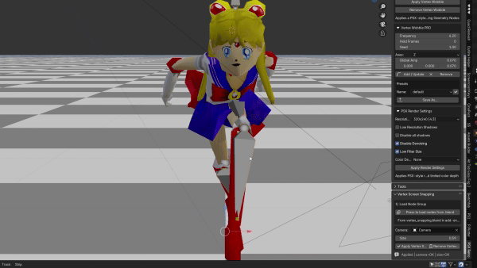

 

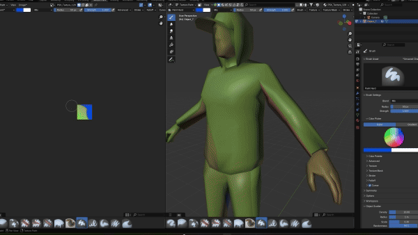

 

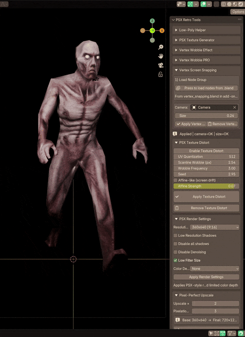

 

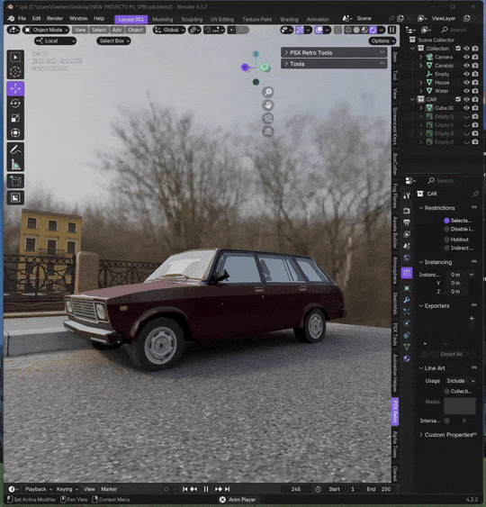

## Current Version

Version `1.7.15`

Highlights from the current release:

- New Applied to status block for the active object
- Crisp Pixel-Perfect Upscale with fractional Pixelation and live updates
- Animated Texture Distort, real 8/16-bit Color Depth, fixed Atkinson dithering
- Render Settings preserves your own compositor; Retro Dither pattern travels with the .blend
- All tools from the 1.7.0–1.7.14 updates included, including Texture Blend and PSX Asset Bake

## Compatibility

- Blender `5.0`–`5.2` for the current `1.7.15` release
- Version `1.6.2` remains available separately for Blender `4.3`
- Packages for Windows x64, macOS (Apple Silicon and Intel) and Linux x64
- Pillow is bundled; NumPy is provided by Blender — nothing extra to install

## Installation

The addon itself is distributed through itch.io:

[Download and install from itch.io](https://fawkek.itch.io/psx-retro-tools)

Download the ZIP for your system and install it in Blender via **Edit → Preferences → Get Extensions → Install from Disk**.

The itch.io page includes:

- the latest addon builds for Windows, macOS and Linux
- installation steps
- version updates and devlogs

[View all PSX Retro Tools devlogs](https://fawkek.itch.io/psx-retro-tools/devlog)

## Source Code

This repository is a public showcase page for PSX Retro Tools.

The addon source code is private and is not included in this repository.

No addon Python files, packaged releases, or proprietary implementation details are published here.

## License

All rights reserved.

This repository does not grant permission to copy, redistribute, repackage, reverse engineer, or reuse the commercial addon source code.

See [LICENSE.md](LICENSE.md) for details.

## Tags

#Blender · #BlenderAddon · #PSX · #PS1 · #PlayStation · #RetroGraphics · #LowPoly · #PixelArt · #Dithering · #VertexWobble · #VertexSnapping · #TextureBaking · #TextureAtlas · #TexturePainting · #GouraudShading · #BillboardSprites · #Compositor · #CRT · #GameArt · #GameDev · #IndieDev · #RetroGameDev

## Links

- itch.io: [PSX Retro Tools](https://fawkek.itch.io/psx-retro-tools)
- Devlog: [All updates on itch.io](https://fawkek.itch.io/psx-retro-tools/devlog)
- X / Twitter: [@fawkek_obj](https://x.com/fawkek_obj)
